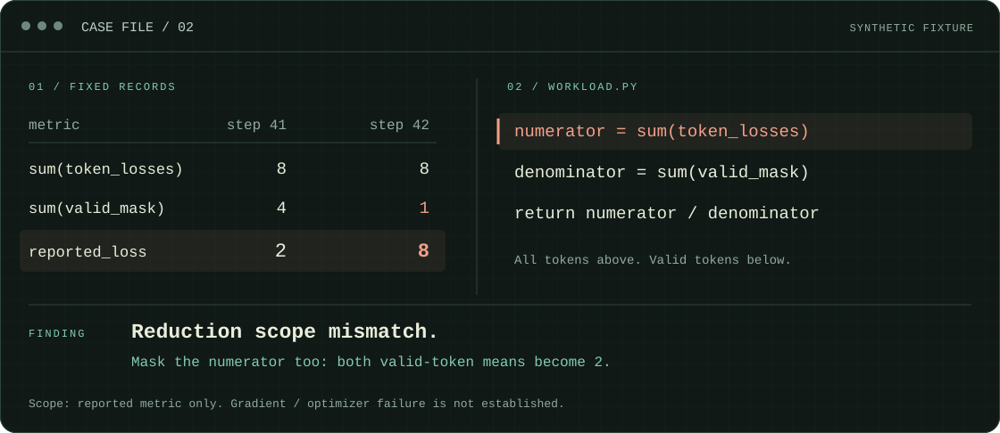

<p align="center">
  
</p>

<h1 align="center">沿着证据，追到原因。</h1>

<p align="center">
  <b>AI 训练与推理的诊断 Skill</b><br>
  报错 · 挂死 · NaN / Inf · 梯度异常 · 跨设备差异 · 偶现复读
</p>

<p align="center">
  
  
  
  
</p>

<p align="center">
  <a href="#快速开始">快速开始</a> &nbsp;·&nbsp;
  <a href="#使用案例">使用案例</a> &nbsp;·&nbsp;
  <a href="#安装">安装</a> &nbsp;·&nbsp;
  <a href="docs/diagnostic-architecture.md">诊断结构</a> &nbsp;·&nbsp;
  <a href="docs/validation.md">验证记录</a>
</p>

---

## 快速开始

把问题、材料路径和限制告诉它。

```text
$debug-agent NPU grad norm 比 GPU 大很多。两端 dump 在 ./npu 和 ./gpu，定位原因，只分析已有数据，不重跑训练。
```

| Codex | Pi | Claude Code |
|---|---|---|
| `$debug-agent <问题>` | `/skill:debug-agent <问题>` | `/debug-agent:debug <问题>` |

已有数据足够就直接分析；有缺口时，再选能改变判断的取证动作。安装后可显式调用，自动选择由宿主决定。

## 使用案例

**Loss 从 2 涨到 8，原因可能藏在指标的分子里。**

<p align="center">
  
</p>

上图根据仓库的[公开合成案例](evals/cases/case-02/request.md)绘制：代码对全部 token 求和，却只按有效 token 计数。分子也应用 mask 后，两步平均值都为 2。材料足以解释指标变化，不能据此确认梯度或参数异常。

这是案例机制展示。模型实际诊断的结果与限制见[验证记录](docs/validation.md)。

## 它怎么追查

| 关联证据 | 缩小范围 | 交付判断 |
|---|---|---|
| 把代码、调用栈和运行记录对应起来。 | 按判据和可信依赖寻找异常，保留未知边界。 | 结论附原始依据，写明适用范围和关键缺口。 |
| 比较 msprobe dump 时，保留跨卡范围、缺失和未匹配项。 | 按需细化、回查或设计实验，复用已有扫描。 | 说明是确认了根因、验证了修复，还是缩小了范围或受阻待续。 |

普通问题直接推进，长任务按需保存证据和恢复进度。工具负责读取、比较与显式判据检查，根因判断由宿主模型完成；取证、实验和真实停止遵守用户授权。

## 安装

需要 **Python 3.10+**，运行脚本仅依赖标准库。在 Agent 实际运行的环境安装；Pi 在 WSL，就在 WSL 安装。

<details open>
<summary><b>Codex / Pi</b></summary>

```sh
git clone https://github.com/Tjh-UKN/debug-agent.git
cd debug-agent
```

| 宿主 | 安装命令 |
|---|---|
| Codex | `python scripts/install.py codex` |
| Pi | `python3 scripts/install.py pi` |

Linux/WSL 若没有 `python`，使用 `python3`。宿主未刷新技能时，重启后再调用。

</details>

<details>
<summary><b>Claude Code</b></summary>

```sh
claude plugin marketplace add Tjh-UKN/debug-agent
claude plugin install debug-agent@debug-agent-marketplace
```

</details>

<details>
<summary><b>更新、检查与安装位置</b></summary>

更新仓库后，在安装命令后加 `--update`；加 `--check` 可只读核对安装内容。更新先备份差异文件，不修改模型配置。

安装位置、更新边界与可选别名见[宿主接入](skills/debug-agent/references/integration.md)。

</details>

## 继续深入

| 阅读 | 内容 |
|---|---|
| [Skill 入口](skills/debug-agent/SKILL.md) | 宿主实际加载的诊断指导 |
| [诊断结构](docs/diagnostic-architecture.md) | S/D 证据与关联、判据，以及异常偏序与细化 |
| [验证记录](docs/validation.md) | 已做的检查、案例结果与未决问题 |
| [评估方法](docs/diagnostic-effectiveness.md) · [公开案例](evals/README.md) | 如何检验诊断行为与结论边界 |

<details>
<summary><b>开发检查</b></summary>

```sh
python -m unittest discover -s tests -t .
```

测试与公开案例留在仓库，不随 Skill 分发。脚本检查通过不代表每次都能正确定位。

</details>

---

<p align="center"><sub>FOLLOW THE EVIDENCE.</sub></p>
