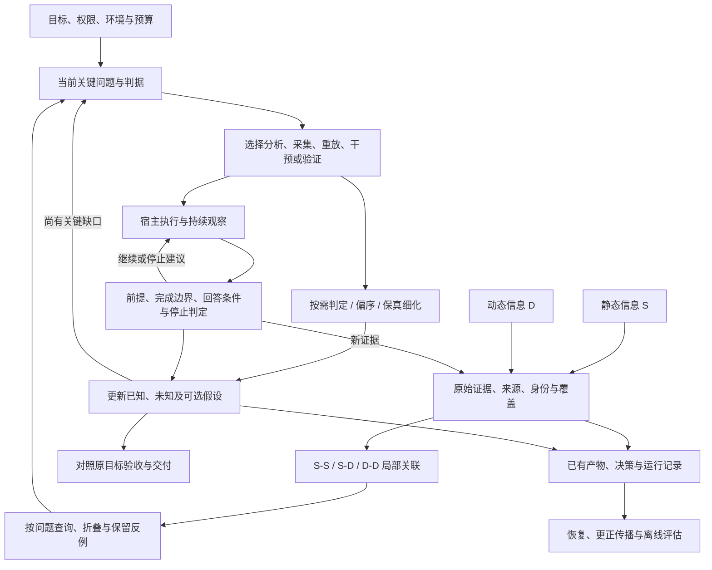

# 诊断结构与实现

0.9.1 将测试集中到仓库 `tests/`，运行包仅保留诊断、证据、恢复和接入文件。panel 卡片渲染器与 display/evaluation 占位参考退役；既有案例数据、更正传播和 trace 查询保留。状态使用 case show 或 recovery resume，经模型直接交付，不再维护另一套卡片展示。

## 目标与理论组成

目标是在用户约束和可接受误判风险内，以更少的实际时间和资源取得足以回答目标问题的证据。结构清晰性、确定性工具正确性和真实诊断收益分别验收；本文不是已经验证的最优策略或全新理论。

本轮依据[用户提供的讨论](https://chatgpt.com/share/6ad9c534-7b7c-83ee-bb8b-01fb4e86d440)保留各阶段的有效结构。后期的自适应决策修正固定路径，不替代前期的信息划分、关联、判定、偏序、保真细化与去噪。

| 理论结构 | 相比本轮起点的缺口 | 本轮落点 |
|---|---|---|
| S/D 与 S-S、S-D、D-D | 原有代码与数据联合分析原则分散，关系语义未集中表达 | diagnosis 参考定义信息来源、执行映射及运行依赖，区分观测/推导/假设 |
| 正常/异常/未知判定 | 统计工具报告差异，尚无明确的可组合三值判定入口 | 明确判据、上下文与覆盖；judge 执行显式样本约束，不自动选领域阈值 |
| 异常偏序 | 保存执行序，但没有运行依赖上的极小异常集合工具 | frontier 使用有来源的局部依赖 DAG，保留并发候选和未知祖先 |
| 保真细化 | 缩减注意事项存在，缺少与判定/剪枝的结构关系 | 在细化时保留输入、状态、组合操作、未知边界及回退条件 |
| 去噪与最小证据选择 | query 可定位，但没有可逆的差异聚焦视图 | differences 视图折叠已比较且未见变化的摘要，保留不确定项与回查 |
| 主动诊断 | 按现场选动作，但缺少与关键未知和决策价值的联系 | 问题→动作→证据→决定；候选假设按需存在，不设置固定 JOR 流程 |
| 实验运行中判定 | 原有完成边界和 cancelled 记录不控制真实运行 | 显式前提、回答/反证条件、无效/冲突/预算判定，可供现场采集循环调用 |
| 目标证据充分性 | 已有根因/修复/缩小/受阻结果 | 区分子问题、实验、规避和整体根因的完成，避免局部结果取消必要验证 |

## 系统关系

图中是逻辑职责，不要求独立服务、全图索引或多 agent。诊断动作可直接从现有材料到结论；JOR 是可组合操作，不是每次必须经过的三个阶段。可靠静态证据可以确认具体机制，无需额外跑实验。

## 运行边界与工具映射

| 职责 | 实现与责任 |
|---|---|
| 目标与诊断决策 | 宿主模型按 SKILL 和当前问题选择，参考按需加载 |
| 可靠读取和视图 | msprobe scan/query/inspect/compare；不把摘要比较当逐元素 Oracle |
| 显式判据与依赖集合 | diagnosis.py judge/frontier；上下文、边与覆盖由调用方提供可复核来源 |
| 运行中判定 | diagnosis.py evaluate 或 evaluate_experiment；只返回决策，不控制外部进程 |
| 真实运行和停止 | 宿主已授权工具或现场合作式退出；核实身份、协调分布式参与方及真实停止 |
| 原始产物 | evidence.py 快照、校验及精确摘录 |
| 持久状态与恢复 | 有需要时复用 case/recovery；不新增并行状态存储或默认调查树 |

正常/异常/未知是观测判定；answered/refuted/invalid/inconclusive/budget 是单次动作的判定原因；root_cause/fix_verified/narrowed/blocked 是已有案例交付状态。三者不能互相替代，脚本不自动写 confirmed 或成功结案。

当前 frontier 不从 msprobe 顺序、时间戳或调查树自动生成依赖。evaluate 的 context/validity/coverage 也不是远端探针事实；调用方必须保存实际证据。错误或不完整图可能有多个首异常候选，unknown 不能当正常剪除。

## 演进与验收

0.9 提供短入口、按需模型、轻量确定性操作和差异视图；0.9.1 裁剪重复入口、卡片展示和开发文件分发。未实现自动重放生成、任意远程作业控制、全局因果图、完整误差传播求解或最优停止求解器。这些能力需要独立场景与收益证据，不能由字段齐全宣称已完成。

确定性验收覆盖：样本判据与缺失、并发异常/未知祖先、推测边不排除候选、前提失效、跨运行混入、冲突事件、早停与预算、查询折叠后的可恢复性及安装兼容。现场运行能力通过受控 CPU 小循环检查接线，不能外推设备效果。

行为评估沿用[现有评估计划](diagnostic-effectiveness.md)，补充不能安全剪枝和不能提前成功的反例。关键指标为充分证据时间、最终交付时间、错误归因与错误早停、遗漏关键证据、设备成本和重复工作。合成回归发现失败模式，未参与设计的真实案例才检验泛化收益。
